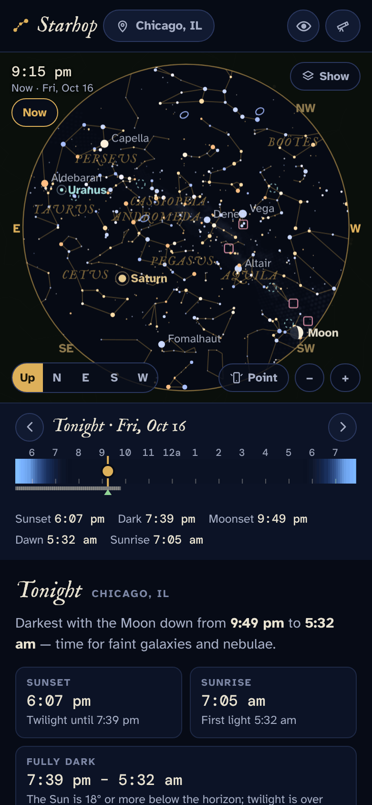
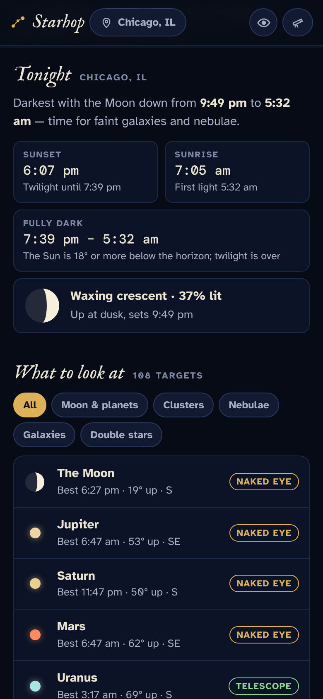
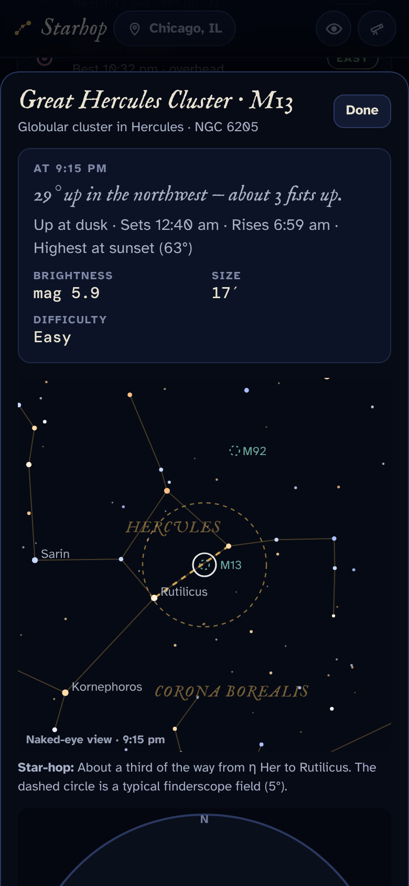

# Starhop

**Use it: [starhop.junkdrawer.works](https://starhop.junkdrawer.works/)**

**What's up tonight from where you are, what's worth pointing a telescope at, and how to find it by hopping from stars you know.** Set where you observe and the telescope you have, and Starhop draws tonight's sky as it looks from there, says when it's properly dark and lists what's worth a look. Tap anything for where to find it: a finder chart with a star-hop from bright stars, and how it will look in your eyepieces. It installs as an app (from the browser's menu, or Share → Add to Home Screen on an iPhone) and works offline once it has loaded.

<p align="center">
  
  &nbsp;
  
  &nbsp;
  
</p>

## What it does

- **Sky map.** Tonight's sky for your location and time: stars down to about magnitude 6, constellation lines and names, the Milky Way, the planets and the Moon (with its phase), plus clusters, nebulae and galaxies.
  - Drag to look around and pinch or scroll to zoom.
  - **Up** shows the whole dome overhead, laid out like a planisphere you hold above your head; **N / E / S / W** face a direction.
  - It shows only what the sky allows: twilight, the Moon and how dark your sky is all change which stars appear.
- **Night timeline.** Sunset to sunrise, shaded through civil, nautical and astronomical twilight, with a band for when the Moon is up. Drag along it to see the sky at any hour, or step to other nights.
- **Tonight.** Sunset, when the sky is fully dark, sunrise, the Moon's phase and hours, and a verdict: a dark night for faint galaxies, or a moonlit one for planets, doubles and clusters.
- **What to look at.** The Moon and planets, then the best-placed deep-sky objects and double stars, ranked for your telescope and your sky. Each shows when it's highest and where to look.
- **Object cards:**
  - **Where to look:** altitude in fists at arm's length, compass direction, and rise, set and highest times.
  - **Finder chart:** a naked-eye view around the target, a 5° finderscope circle, and a star-hop, e.g. "about a third of the way from η Her to Rutilicus" for M13.
  - **Your telescope:** magnification and field for each eyepiece, which one to use, and a sketch of the eyepiece view.
  - **Planets:** Jupiter's four moons in their positions for that time, Saturn's rings at their current tilt, and the phases of Venus and Mercury.
- **Coming up.** Moon phases, meteor shower peaks (with how much the Moon interferes), planet oppositions and elongations, the Moon passing bright planets, and eclipses seen from your location.
- **Point at the sky** (phones, on the website). Tap **Point** and the map fills the screen and follows where the back of your phone points.
  - Phone compasses are rough, and a metal telescope nearby makes them worse. If the map doesn't match the sky, drag it onto a star you recognize; the phone remembers the correction.
  - The screen stays on while you point.
  - Inside claude.ai the page can't read the phone's sensors, so pointing only works on the website.
- **Use my location** in the location sheet, also on the website; elsewhere, search for a town or enter coordinates.
- **Night vision.** Everything turns dim red so your eyes stay dark-adapted at the eyepiece.
- **Remembered in the browser:** your location, telescope, eyepieces, sky and the objects you mark as seen.

## How it works

- **Positions.** The Sun, Moon and planets come from [Astronomy Engine](https://github.com/cosinekitty/astronomy) (MIT), version 2.1.19, kept in `js/` so it works offline. The same library supplies rise and set times, twilight, moon phases, Jupiter's moons, Saturn's ring tilt, elongations, oppositions and eclipses.
  - Stars and deep-sky objects are J2000 catalog positions, turned to altitude and azimuth with its rotation matrices.
- **Fonts.** Atkinson Hyperlegible, DM Mono and IM Fell English (SIL Open Font License) are in `fonts/`, served from here so nothing loads from elsewhere.
- **Map projection.** Stereographic, the projection planispheres use. It keeps constellation shapes true, and the horizon is always a circle, which makes the ground easy to draw.
- **Time zones.** Every time is shown in the observing location's own time zone, whatever the device is set to.
- **Difficulty ratings are a rule of thumb:**
  - **Galaxies and nebulae:** the object's surface brightness is compared with the sky's, helped by aperture and penalized by moonlight. For big objects the rating uses the bright core, which is what you see first.
  - **Double stars:** rated by the power needed to split them (roughly 240 ÷ separation in arcseconds), against your telescope's resolving limit and the highest power your eyepieces reach.
- **Star-hops.** Starhop looks for two bright stars with the target on or near the line between them, preferring short, bright, well-aligned pairs. When there is no such pair, it falls back to the nearest bright star.

## Running it

It's a static site: one HTML page plus a few data files, with no build step and no server code. Host the folder anywhere static, or serve it from here:

```sh
python3 -m http.server        # then open http://localhost:8000
npm test                      # uses the page in Chromium through Playwright, with the place and date pinned so the sky is the same every run
npm install                   # once, for the PNG encoder the screenshots use (upng-js)
node tools/screenshots.mjs    # redraws docs/*.png and og.png
node tools/make-icons.mjs     # redraws the PNG icons from icon.svg
python3 tools/build_data.py   # rebuilds data/; the steps to fetch its sources are at the top of the script
```

Opening `index.html` straight from disk won't work, because browsers block reading the data files that way. Pointing at the sky and **Use my location** need a secure address: https, or localhost.

To put it online with GitHub Pages: **Settings → Pages → Build and deployment → Deploy from a branch**, then pick `main` and `/ (root)`. The `CNAME` file gives it its own address.

### Files

- `index.html`: the whole app: the sky map, the night's timeline, tonight's summary, the targets and their ratings, the object cards with their finder charts, star-hops and eyepiece views, and the telescope and location sheets. Your settings are kept in the browser's localStorage.
- `js/astronomy.browser.min.js`: [Astronomy Engine](https://github.com/cosinekitty/astronomy) 2.1.19 (MIT), served from here.
- `data/`: the stars, constellations, deep-sky objects, Milky Way and cities, built by `tools/build_data.py`. [data/SOURCES.md](data/SOURCES.md) has their licenses.
- `fonts/`: Atkinson Hyperlegible, DM Mono and IM Fell English (SIL Open Font License), served from here so nothing loads from elsewhere.
- `sw.js`: keeps the page, the library, the data files and the fonts for using offline.
- `carry.js`: brings your settings over from Starhop's old address, junkdrawer.works/starhop, the first time it opens here.
- `manifest.webmanifest`, `icon.svg` and the `icon-*.png` icons let it install; `og.png` is the link preview.
- `tools/`: `build_data.py` and `wgsn.tsv` for the data, `screenshots.mjs`, and `make-icons.mjs` with `icon-full-bleed.svg`.
- `test/e2e.mjs`: the test, which drives the real page in Chromium.

## Data

`data/` holds compact files built by `tools/build_data.py` from:
- [d3-celestial](https://github.com/ofrohn/d3-celestial) 0.7.35 (BSD-3-Clause), which provides:
  - the Hipparcos-based star catalog and star names;
  - IAU constellation lines;
  - the Milky Way outline, resampled here into a grid of soft glows;
  - SEDS Messier data and other deep-sky objects.
- [city-timezones](https://github.com/kevinroberts/city-timezones) 1.3.4 (MIT): 7,300 cities with their time zones.
- The [IAU Catalog of Star Names](https://exopla.net/star-names/modern-iau-star-names/) (public domain), kept in `tools/wgsn.tsv`: where d3-celestial gives one traditional name to several stars, only the star the IAU gives it to keeps it, and the others go by their Bayer or Flamsteed labels.

The double-star notes and object descriptions were written for Starhop. The steps to rebuild are at the top of the build script, and [data/SOURCES.md](data/SOURCES.md) has the licenses.

## License

MIT — see [LICENSE](LICENSE). The data in `data/` keeps its sources' licenses, listed in [data/SOURCES.md](data/SOURCES.md), and the fonts in `fonts/` keep the SIL Open Font License.
